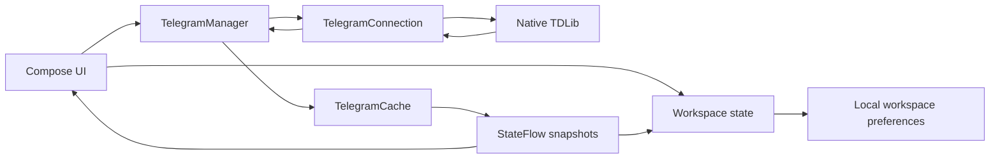

# MARAGRAM architecture

This describes the current local standalone project. Some implementation and test files are local uncommitted changes, so it is not a description of a verified public release.

## Build boundaries

The root [settings](../settings.gradle.kts) include `:app` and `:easytdlib`. The application depends on the library. Nested projects such as `telegram/` are separate from the root build unless explicitly included.

| Component | Responsibility |
| --- | --- |
| `app/.../MainActivity.kt` | Initializes analytics and language settings, obtains the Telegram manager, and renders Compose authentication routing. |
| `app/.../core/EngineModule.kt` | Supplies an application-context Telegram manager and initializes its client. |
| `app/.../ui/CommonUi.kt` | Contains `AuthRouter`, which renders UI according to authorization state. |
| `app/.../ui/ZuiViewModel.kt` | Holds camera, node, window, selection, and workspace settings; saves and restores spatial state. |
| `app/.../ui/screens/ZuiScreen.kt` | Implements the spatial workspace, pan/zoom gestures, chat windows, and message input. |
| `easytdlib/.../engine/TelegramManager.kt` | Coordinates sessions, authorization, requests, and observable Telegram state. |
| `easytdlib/.../engine/TelegramConnection.kt` | Adapts native TDLib calls behind an injectable connection boundary. |
| `easytdlib/.../engine/TelegramCache.kt` | Maintains observable chat, user, file, and message snapshots. |
| `easytdlib/.../core/AnalyticsManager.kt` | Stores installation/usage counters and makes Turso HTTP requests. |

Paths abbreviated with `...` refer to `src/main/java/com/unknown/maragram` within each module. The module also contains generated bindings under `org/drinkless/tdlib`.

## Request and update flow

Authentication uses the manager's authorization state and request methods for phone number, verification code, and password. Message input submits a chat ID and text to `sendMessage`. The connection factory loads `tdjni` and creates a TDLib client; incoming callbacks reach the manager and cache.

The current manager implementation guards session lifecycle and stale callbacks during close/restart and account switches. Local unit tests use a fake connection to exercise these paths without opening a real Telegram session. That testing boundary does not validate native binary loading or live service behavior.

## Persistence and configuration

`ZuiViewModel` stores a JSON representation of workspace state in the private `zui_spatial_state` preferences. This is separate from TDLib's session data under the application's files directory and the analytics preferences.

Both build scripts read the root `local.properties`. The library uses `TELEGRAM_API_ID` and `TELEGRAM_API_HASH`; Turso settings are generated into build configuration as well. Release signing is configured separately by the application. [local.properties.example](../local.properties.example) lists the relevant keys without real credentials.

The current manifest enables Android backups. Backup treatment of session files, telemetry disclosure and controls, and authorization of direct backend requests require review before distribution. Embedded BuildConfig values are available to a person inspecting the APK and must not grant privileged backend access.

## Native dependencies and licensing

The root library contains `arm64-v8a` native libraries, including `libtdjni.so`, and generated `Client.java` / `TdApi.java` bindings. Both modules restrict the configured native ABI to ARM64. The existing local upstream materials identify EasyTDLib and TDLib-related origins; verify exact versions and provenance before publishing a reproducible release.

Preserve upstream notices. A root project license has not been established by this documentation update, and notices for one component do not establish licensing for all local experimental source trees.

## Verification status

Source inspection confirmed these boundaries and the presence of library unit tests. An attempt to run Gradle compilation and unit tests returned `Access is denied` in the editing environment. No runtime, device, or fresh-checkout build success is claimed.
